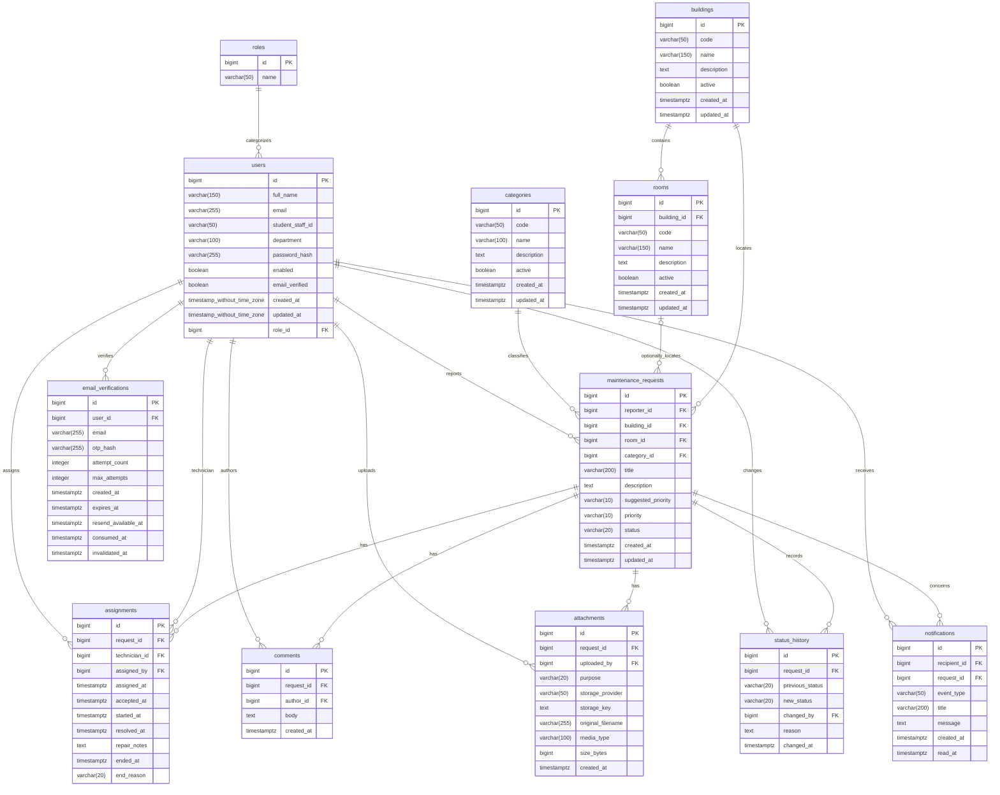

# FF-02 relational schema

The seven migrations define 12 domain tables in `public`. Flyway adds its own
`flyway_schema_history` infrastructure table. New primary keys are BIGINT
GENERATED BY DEFAULT AS IDENTITY. New timestamps are TIMESTAMPTZ; the existing
users timestamps remain TIMESTAMP WITHOUT TIME ZONE. The request BIGINT ID is
its initial unique request identifier. No Java feature mappings or APIs are
implemented by FF-02.

## Complete ER diagram

All columns are shown. SQL migrations are authoritative for defaults, lengths,
checks, unique constraints, and indexes. An optional room must belong to the
request's mandatory building.

## Relationships and location integrity

Every non-null FK references one parent; parents may have zero or many children.
`maintenance_requests.building_id` is required, while `room_id` is optional.
A separate building FK validates building-only requests. The composite
`(building_id, room_id)` FK uses MATCH SIMPLE and references the unique
`rooms(building_id, id)` constraint: NULL room means building-only, and a
non-null room must match the building. This also rejects moving a referenced
room to another building. Deactivate buildings/rooms instead of deleting them.
Room codes are unique within buildings; building/category codes are unique.
Codes remain case-sensitive.

New FKs use ON DELETE RESTRICT / ON UPDATE RESTRICT. The existing users-role
FK retains its original default NO ACTION behavior. No cascading deletion is
introduced. References ensure existence, not actor roles, ownership, or active
state; those service rules belong to FF-04 through FF-09.

## Request and history storage

Suggested and operational priorities are stored independently and accept LOW,
MEDIUM, HIGH, URGENT. Later request creation initializes the operational value
from the suggested value; administrators can change it subsequently.
Statuses are OPEN, VERIFIED, ASSIGNED, IN_PROGRESS, RESOLVED, CONFIRMED, CLOSED,
REJECTED, ON_HOLD, REOPENED. Checks constrain values, not transition paths.
Cancellation and return paths from hold/reopening remain FF-07 decisions.

Each assignment row is an episode. A partial unique index permits at most one
row with ended_at IS NULL per request. Reassignment ends the existing episode
with REASSIGNED and creates another; resolution ends it with RESOLVED and
requires repair notes. Reopening creates a new episode when assigned again.
Original technician/assigner and timestamps must not be overwritten. Acceptance,
start, resolution, and ending checks enforce chronological prerequisites,
including explicit handling of NULL values. Equal timestamps are permitted.

Status history records the actor, previous/new state, reason, and timestamp.
The initial record has NULL previous_status and OPEN new_status; a partial
unique index allows at most one initial record per request. Rejection requires
a nonblank reason. Request state, assignments, and history must be updated in
one transaction by later workflow services; constraints do not guarantee an
initial event exists or that current state matches the latest event.

Comments and status events are append-only by application policy. FF-02 does
not add trigger-based workflow logic or a database privilege system; table
owners can still edit records. Later services must enforce append-only access.
Default updated_at values are not update triggers: future services maintain
updated_at explicitly. Use a consistent UTC interpretation when mapping the
legacy users timestamps; their original type/default is intentionally preserved.

## Communication, verification, and retention

Attachments store validated metadata and external provider/object references,
never image bytes, credentials, or expiring signed URLs. Purpose is ISSUE_PHOTO
or REPAIR_EVIDENCE. Evidence is request-level, not tied to an assignment episode.
File limits, storage operations, and access checks belong to FF-09.

Notifications are request-related and recipient-specific. NULL read_at means
unread; non-null read_at cannot precede creation. Event codes are application
values rather than a prematurely fixed enum. Reading never deletes records.
No automatic notification cleanup is implemented; retention duration and any
account deletion/anonymization policy remain future decisions.

Email verification stores OTP hashes only. Six-digit OTP generation/hashing,
secure comparison, delivery, attempt enforcement and concurrency belong to
FF-04. Each challenge snapshots its attempt limit, expiration and resend time.
Only one non-consumed, non-invalidated challenge may exist per user. Expiry is
checked at use time; it does not automatically free that unique slot. Resend
invalidates the previous challenge and inserts a new one transactionally.
Consumed/invalidated are mutually exclusive; consumption must be within the
challenge lifetime. Account email must still match the challenge email at use.

No retention cleanup runs in FF-02. Verification hashes should eventually be
purged under an approved short retention policy; no indefinite-retention policy
is implied. User/request deletion is restricted while dependent records exist.

## Index choices

PK/unique constraints provide their own indexes. Rooms additionally require
unique (building_id, id) for the composite FK. Request indexes support reporter
history, building/room filtering, category filtering, and status listings.
Child request/time indexes support ordered assignment, history, comment, and
attachment retrieval. Assignments have technician/ended_at lookup and current
assignment uniqueness. Notifications have recipient/time, unread-only, and
request indexes. Verification has user/time, outstanding uniqueness and expiry
indexes. No duplicate standalone building index, boolean-only index, or
speculative full-text/priority/audit-actor index is added. Unindexed actor FKs
remain enforced; indexes can follow measured query requirements.

## Requirement boundaries

FF-02 requires the tables, reference seeds, integrity, migrations and tests.
FF-04 supplies identity/OTP storage requirements; FF-05 supplies category seeds
and deactivation; FF-06/07/08 supply request, priority, lifecycle and assignment
history needs; FF-09 supplies communication/evidence/notification needs.
Column lengths, code case sensitivity, assignment end policy, request-level
evidence and initial retention behavior are engineering decisions from the
approved design. FF-03 owns JPA mappings; later issues own application behavior.
See [database-migrations.md](database-migrations.md) for adoption and testing.
